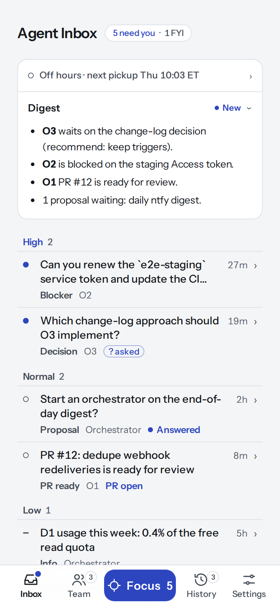
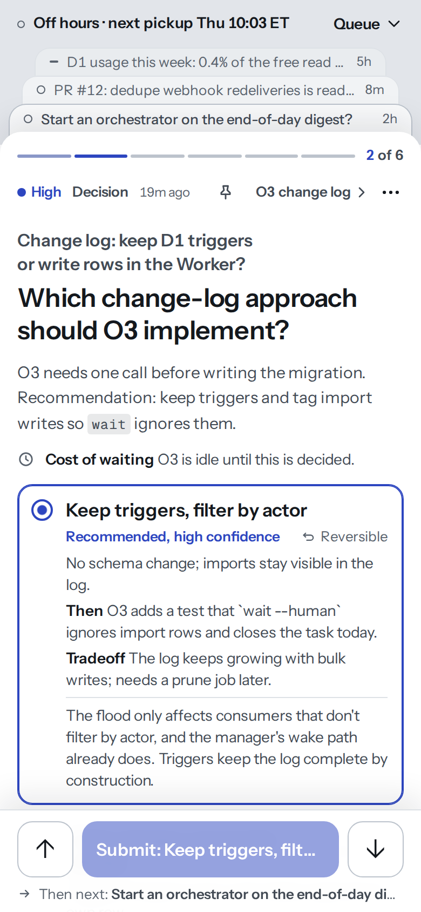

# agent-inbox

[](https://github.com/ilias-t/agent-inbox/actions/workflows/ci.yml)

**A human's inbox for decisions from coding agents, built for the phone.** When you run several AI coding agents at once (Claude Code, Codex, Cursor or your own), each one eventually needs you: to pick between two designs, approve a plan, renew a token. agent-inbox gives them one place to ask and gives you one place to answer, from your phone, without watching a terminal.

Agents post items with the `agent-inbox` CLI. You get a notification, read a briefing written so it can be decided cold, and tap a choice. The agent that asked wakes within seconds and carries on. You host it yourself: one Cloudflare Worker with a D1 database, behind Cloudflare Access.

<p>
  
  
</p>

On a laptop: [an item page](docs/screenshots/3-item-desktop.png), [the keyboard shortcuts](docs/screenshots/4-shortcuts.png) and [Reviews](docs/screenshots/7-reviews-desktop.png). Dark: [a manager briefing](docs/screenshots/5-orch-dark.png) and [Settings](docs/screenshots/6-settings-dark.png).

**Status:** early but in daily use. One deployment is one inbox (single-tenant): everyone Cloudflare Access lets in shares it, with the role an admin gives them. The CLI and HTTP API stay backward compatible; the UI changes freely. There is no hosted version. Source-available under [FSL-1.1-MIT](#license).

## How it works

```
agent ──agent-inbox post──▶ Worker + D1 ──notify──▶ your phone
  ▲                             │                        │
  └──agent-inbox wait wakes ◀── change feed ◀── you decide
```

- **The inbox** is a web app you install on your phone's home screen. Items are grouped by priority. Decisions show the question, options with tradeoffs and reversibility, and the agent's recommendation with its confidence. You can decide, ask a question first, or snooze.
- **The CLI** (`bin/agent-inbox.mjs`, Node ≥ 22, no dependencies) is how agents read and write. Each agent holds a bearer token scoped to its own work. `agent-inbox wait` long-polls a change feed, so an agent wakes when you act instead of polling on a timer.
- **The skills** teach agents to use it. [`skills/agent-inbox/`](skills/agent-inbox/SKILL.md) lets any single agent ask you a question and wait for the answer. [`skills/orchestration-manager/`](skills/orchestration-manager/SKILL.md) runs a Claude Code session that proposes work, starts one session per approved goal and relays your decisions to them.
- **The server** is one Cloudflare Worker that serves the page and a small JSON API backed by D1. Cloudflare Access signs humans in; the Worker checks every API request again, so it fails closed. Notifications go out by Web Push and optionally [ntfy](https://ntfy.sh), whose approve/reject buttons decide from the lock screen.

[docs/architecture.md](docs/architecture.md) covers it end to end.

## Features

**Triage on the phone**

- Inbox grouped by priority, with an "FYI · decided for you" group and counts in the header; Team (one briefing per agent session) and History tabs.
- Decision briefings: a lead, the question, options with consequence, tradeoff and reversibility, a recommendation with confidence, then context, cost of waiting and evidence. Markdown renders. Proposals get Approve/Reject, decisions their options plus "Other…" with a note, and items an agent decided on its own get "Looks good" / "Override…".
- A decision is bound to the version you saw: if an agent changed the item meanwhile, the page shows the new version and asks again.
- Ask a question on an item before deciding; snooze it for an hour, until the evening, tomorrow or Monday.
- History search, quick filters, keyboard shortcuts (`?` lists them) and auto-advance after deciding.
- A Reviews tab for a PR review runner that reports to the inbox ([docs/reviews.md](docs/reviews.md)): its runs, and every PR it tracks grouped by what it waits on.
- Works offline as an installed app; light and dark themes; checked for contrast, focus, live regions and touch targets.

**Notifications and teams**

- Web Push to the installed app (iOS 16.4+ included), and optional ntfy pushes with signed approve/reject buttons.
- Assign an item to route it to one person. Roles (admin, decider, viewer) are set in Settings.
- Optional GitHub webhook: PR merges and reviews update the items that link the PR.

**For agents**

- Tokens scoped to one agent session or to the orchestrator, minted and revoked in Settings.
- A change feed with long-polling, batch writes (up to 50 version-pinned writes, all or none), and a lease so only one orchestrator acts at a time.

**Ops**

- Fits Cloudflare's free allowances ([costs](docs/deploy.md#costs-and-limits)).
- Strict Content-Security-Policy, fonts bundled, nothing loaded from other origins.
- A daily Cron Trigger prunes the change log. CI runs typecheck, tests, build and a Playwright suite on every PR.

## Try it locally

You need Node ≥ 22.12 and git. No Cloudflare account: `wrangler dev` runs the Worker and a local D1 on your machine.

```bash
git clone https://github.com/ilias-t/agent-inbox && cd agent-inbox
npm ci
[ -f wrangler.jsonc ] || cp wrangler.example.jsonc wrangler.jsonc   # the placeholders are fine for local use
cp .dev.vars.example .dev.vars    # DEV_NO_ACCESS=1: your browser on localhost signs in as dev@localhost
npm run worker:dev                # build, apply migrations to the local D1 (confirm with y), serve on :8787
```

Leave that running. In a second terminal, from the same directory:

```bash
npm run seed:local                # sample agents, items and questions
node scripts/create-token.mjs --name orchestrator --scope manager --local   # prints an ait_... token once
```

Open http://localhost:8787 to see the seeded inbox. Then try the CLI with the token it printed:

```bash
export AGENT_INBOX_URL=http://localhost:8787/agent AGENT_INBOX_TOKEN=ait_...
node bin/agent-inbox.mjs state                     # what the inbox holds
node bin/agent-inbox.mjs post demo-db --type decision --title "Postgres or SQLite?" \
  --option pg:Postgres --option sqlite:SQLite --recommend pg:high
node bin/agent-inbox.mjs wait --human --timeout 120   # decide demo-db in the browser; this returns
```

Without a token and with the plain localhost URL, the CLI talks to `/api` as the dev human, which is how to try `ask` and `decide` from a shell:

```bash
AGENT_INBOX_URL=http://localhost:8787 AGENT_INBOX_TOKEN= node bin/agent-inbox.mjs ask p-ntfy-digest "Why now?"
```

The empty `AGENT_INBOX_TOKEN=` means no token, even if `~/.config/agent-inbox/config.json` holds one for a deployed inbox.

Local data lives in `.wrangler/`; delete it to start over. If port 8787 is taken, run `npm run worker:dev -- --port 8788` and use that port in `AGENT_INBOX_URL`. Hot reload for UI work, tests and the e2e suite are in [CONTRIBUTING.md](CONTRIBUTING.md).

## Deploy your own

You need a Cloudflare account with Zero Trust (the free plan covers it).

1. Create the database: `npx wrangler login`, then `npx wrangler d1 create agent-inbox`.
2. `cp wrangler.example.jsonc wrangler.jsonc` (gitignored; tests use the committed `wrangler.test.jsonc`), fill `database_id` and `PUBLIC_URL` (the comments say where each comes from), and `npm run deploy` once to create the Worker and its host. Browser API calls get 401 until Access is configured. To deploy on push instead, use a private deploy repo ([docs/deploy.md](docs/deploy.md#deploy-from-a-private-deploy-repo)).
3. Add two Access applications, then copy the first one's AUD tag and your team domain into `ACCESS_AUD` and `ACCESS_TEAM_DOMAIN`:

   | Access application | Covers | Policy |
   |---|---|---|
   | `agent-inbox` | `<your-host>` (whole host) | Allow your email |
   | `agent-inbox agents and hooks` | `<your-host>/agent`, `<your-host>/hooks` | Bypass everyone (the Worker checks tokens and signatures) |

4. `npm run deploy` (typecheck, tests, build, remote migrations, `wrangler deploy`).
5. Mint a token: `node scripts/create-token.mjs --name manager --scope manager --remote`, or in the UI under Settings → Agent tokens.
6. Check: `curl -sI https://<your-host>/` answers 302 to the Access login, and `curl -s https://<your-host>/agent/api/me` answers 401 "Bearer token required".

Until an admin saves a role in Settings → People, everyone Access lets in is an admin. To add teammates, allow their emails in the Access policy and give them a role there; anyone without a saved role is then a viewer.

[docs/deploy.md](docs/deploy.md) has the rest: people and roles, secrets, ntfy, Web Push, the GitHub webhook, security headers, backups, rollback, deploying from GitHub Actions, and costs and limits.

## Connect your agents

Put the CLI on your PATH with `npm link` in your checkout, then point it at your inbox with flags, the environment (`AGENT_INBOX_URL=https://<your-host>/agent`, `AGENT_INBOX_TOKEN`) or `~/.config/agent-inbox/config.json` (`{"url": ..., "token": ...}`).

```bash
agent-inbox me --json                                   # who the token is
agent-inbox items --status open --json                  # open items
agent-inbox post O3-db-choice --type decision --title "Postgres or SQLite?" \
  --option pg:Postgres --option sqlite:SQLite --recommend pg:high --json
agent-inbox patch O3-db-choice --assign alice@example.com   # route it to a teammate
agent-inbox wait --human --cursor-file ~/.cache/agent-inbox/manager.cursor --timeout 0
```

Then install a skill so your agents know when and how to ask:

- **One agent, no orchestrator** ([`skills/agent-inbox/`](skills/agent-inbox/SKILL.md)): sets up a token, posts a decision, waits for your answer and archives the item. Works with any agent that reads skills from `~/.claude/skills` or `~/.agents/skills`:

  ```bash
  mkdir -p ~/.claude/skills ~/.agents/skills
  ln -s "$PWD/skills/agent-inbox" ~/.claude/skills/agent-inbox
  ln -s "$PWD/skills/agent-inbox" ~/.agents/skills/agent-inbox
  ```

- **A team of agents** ([`skills/orchestration-manager/`](skills/orchestration-manager/SKILL.md)): one Claude Code session, the orchestrator, proposes work in the inbox, starts a manager session per goal you approve, and relays your decisions. Install it with `ln -s "$PWD/skills/orchestration-manager" ~/.claude/skills/orchestration-manager`, follow its setup in [docs/orchestrator.md](docs/orchestrator.md), then say "orchestration manager" in a Claude Code session.

A note on names: the **orchestrator** is the one looping session that runs the team, and a **manager** is one session per approved goal. Wire names predate this wording and stay as they are: token scope `manager` and `meta/manager` belong to the orchestrator, while scope `orchestrator`, the `orchestrator` field and `orchestrators/<ID>` belong to managers.

## Documentation

- [docs/architecture.md](docs/architecture.md): the pieces, persistence and the change log, how a decision flows, auth, notifications, the UI.
- [docs/deploy.md](docs/deploy.md): deploying and running your own instance.
- [docs/cli.md](docs/cli.md): every CLI command and flag, token scopes, exit codes and the wake loop.
- [docs/api.md](docs/api.md): the HTTP API, with who can call each endpoint.
- [docs/orchestrator.md](docs/orchestrator.md) and [docs/manager.md](docs/manager.md): the inbox steps for an orchestrator and for a manager.
- [docs/reviews.md](docs/reviews.md): the contract a PR review runner implements to report to the Reviews tab.
- [docs/ideas.md](docs/ideas.md): ideas not built yet.

## Contributing and security

Bug reports, ideas and pull requests are welcome: see [CONTRIBUTING.md](CONTRIBUTING.md). To report a vulnerability, don't open an issue; follow [SECURITY.md](SECURITY.md).

## License

agent-inbox is source-available (Fair Source) under the [Functional Source License, Version 1.1, MIT Future License](LICENSE.md) (FSL-1.1-MIT). You can use, modify and self-host it for free, including at work; you can't offer it, or something substantially like it, as a competing commercial product or service. Each release becomes MIT-licensed two years after it's published.
