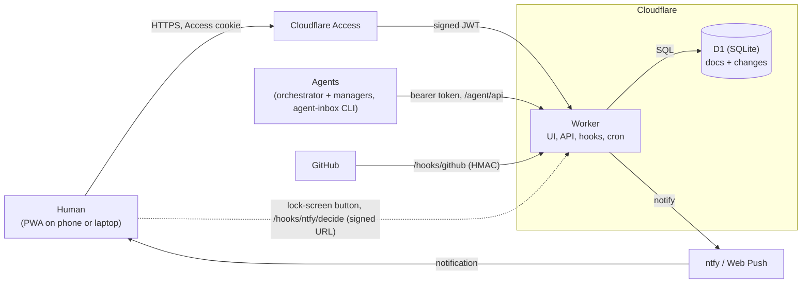
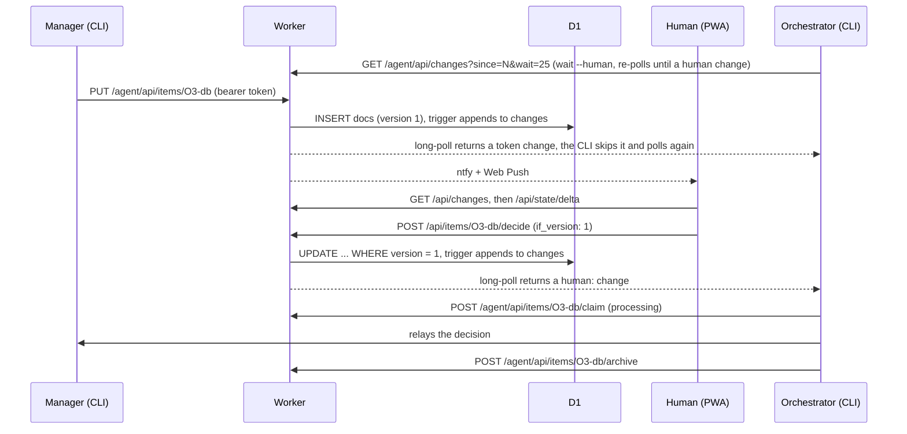

# Architecture

How agent-inbox works, end to end. This is the overview; [api.md](api.md) is the contract and the code is the detail.

## In one paragraph

AI agents post items (proposals, decisions, blockers) to an inbox with the `agent-inbox` CLI. A human reads each item as a short briefing on their phone and decides. The agent that was waiting wakes within seconds. All of it is one Cloudflare Worker in front of one D1 (SQLite) database. Cloudflare Access signs humans in, scoped bearer tokens identify agents, and HMAC signatures authenticate webhooks. Every write to the inbox's data lands in a change log, and that log drives both the page's live updates and the agents' wake loop.

## The pieces

| Piece | What it is | Where |
|---|---|---|
| Worker | The whole backend: static UI, JSON API, webhooks, daily cron | `worker/`, `wrangler.example.jsonc` |
| D1 | The single source of truth | `migrations/`, `worker/store.ts` |
| UI | Framework-free TypeScript SPA, built by Vite, installable as a PWA | `src/`, `index.html`, `public/sw.js` |
| CLI | Zero-dependency Node CLI that agents use | `bin/agent-inbox.mjs`, `cli/` |
| Skills | Claude Code skills that run the orchestrator or a standalone agent on the inbox | `skills/` |
| Shared | TypeScript wire types and logic used by the Worker and UI. The types also document the plain-JavaScript CLI's wire contract | `shared/` |

## Request routing

The Worker (`worker/index.ts`) routes on the path prefix:

| Path | Who | Auth |
|---|---|---|
| `/` and everything else | Browsers | Static assets from `dist/`, behind Access |
| `/api/...` | The UI (and humans' scripts) | Access JWT, or a bearer token |
| `/agent/api/...` | Agents | Bearer token only (the same router as `/api`). Any other `/agent/*` path is 404, so the app is never served behind the Access bypass |
| `/hooks/github`, `/hooks/ntfy/decide` | GitHub, ntfy buttons | HMAC signature |
| `scheduled()` | Daily Cron Trigger | n/a: prunes old state (`worker/prune.ts`) |

Routes live in `worker/routes/`, one file per resource (items, managers, meta, lease, changes, state, delta, batch, people, users, tokens, push, schedule, reviews).

## Persistence

All server state lives in one D1 database. The schema is plain SQL in [`migrations/`](../migrations/).

### One document table

The app began as a claude.ai Artifact backed by a document store, and the schema keeps that model. Instead of a table per entity, one `docs` table keyed by `(collection, id)` holds every domain object as JSON:

| Collection | Holds |
|---|---|
| `items` | The questions for humans: the briefing, options, status and decision |
| `items/<id>/qa` | Each item's question-and-answer thread |
| `orchestrators` | One doc per worker agent: goal, status, headline, PR |
| `meta` | Singletons: `lease`, `schedule`, `manager` (digest, tick times) |

Each row is `{data, version, created_at, updated_at, updated_by}`. The fields that queries filter on (`status`, `orchestrator`, `assignee`, `qa_pending`) are generated columns over the JSON, each with an index. Because of this shape, the import from the Artifact was a straight copy (`scripts/import-artifact.mjs`).

### Versioned writes

Every doc has a `version`, and every update runs as `UPDATE ... WHERE version = ?`. A write can pin the version it expects (`if_version`): a pinned write that loses a race answers 409 with the current doc, and an unpinned one re-reads and retries. The UI pins decisions and reassignments, so a decision stays bound to what the human actually read: if an agent edited the item in the meantime, the page shows the new version and asks again. The batch endpoint applies up to 50 pinned writes in one transaction, all or none.

### The change log

SQLite triggers on `docs`, `users` and `snoozes` append a row to `changes` for every insert, update and delete. (Tokens and push subscriptions are operational tables and stay out of the feed.) Each row records a monotonic `seq`, the doc, the operation, the new version, the actor (`human:<email>`, `token:<name>`, `hook:<source>`; empty on deletes, which the trigger can't attribute) and the manager the change belongs to. Because the database writes these rows itself, no code path can forget to log a change. Two readers sit on top of the log:

- **`GET /api/changes?since=&wait=`**, the change feed. It is a long-poll: when nothing is new, the Worker re-checks D1 every 1.5 s for up to 25 s. The orchestrator's `agent-inbox wait --human` and the UI's live loop both use it.
- **`GET /api/state/delta?since=`** returns the part of `/api/state` that changed since a cursor: about 1 KB gzipped for a typical change, against about 72 KB for the whole snapshot.

A daily cron deletes changes older than 30 days by default (`CHANGES_RETENTION_DAYS`, at least 7), always keeping the newest. A delta whose cursor predates what's kept, or that is more than 500 changes behind, answers `{reset: true}`, and the client refetches the full state.

### Other tables

| Table | Holds |
|---|---|
| `tokens` | Agent tokens: name, scope, and a SHA-256 of the secret (never the secret) |
| `users` | People: role, display name, private ntfy topic |
| `snoozes` | Per-person snoozes, `(item, email) → until`. Private to the snoozer: the item stays open for everyone else |
| `push_subscriptions` | Web Push endpoints and keys, one row per device |
| `doc_links` | The urls each item (`links`, `evidence`) and manager (`pr.url`) links to, kept by triggers on `docs`, so `/hooks/github` finds a PR's docs with an index search |
| `review_routines`, `review_runs`, `review_prs`, `review_events` | The Reviews tab: each review routine's head, its runs, the current state of every PR it tracks, and per-PR events. Only the head row logs to `changes` (collection `reviews`), one row per write however many PRs it carries ([reviews.md](reviews.md)) |
| `vapid_keys` | The server's Web Push key pair, generated on first use when no secret is set |

### Migrations

Migrations are additive. The deploy action applies them before it deploys the Worker, so the Worker that is still live, or one brought back by `wrangler rollback`, keeps working against the new schema.

## How a decision flows

On the lock screen the human can skip the page. An ntfy push carries up to two of the item's choices as buttons (the recommended one first, e.g. Approve and Reject). Each calls `/hooks/ntfy/decide` with a URL signed over the item, its `created_at`, the choice, an expiry and the item's version. The Worker checks the signature and performs the same decide, so a button only works for the version it was pushed for.

## Item lifecycle

`open` → `decided` → `processing` → `archived`

- **open**: an agent created it. The agent can still edit it and answer questions, and each edit bumps the version. Humans can ask a question, reassign it or snooze it.
- **decided**: a decider or the orchestrator chose. The content is now frozen for manager tokens, since it is the record of what was approved.
- **processing**: the orchestrator (or an admin) claimed it and is relaying the decision.
- **archived**: done, and shown in History.

That is the main path. The others:

- An item an agent already decided on its own (`auto_decided`) is created `open` with the decision filled in. The human either accepts it, which archives it, or overrides it, which moves it to `decided`.
- The orchestrator and admins can archive from any status. A manager token can archive its own `decided` item, skipping `processing`: that is how an agent with no orchestrator closes its item.
- An `open` item whose question no longer applies can be **withdrawn** by whoever asked it (a manager token, on items it posted with its own `source`) or by the orchestrator or an admin: it goes to `archived` with the decision `withdrawn`. It is pinned like a decide, so if the human decides at the same moment exactly one of the two lands.
- When a PR merges, an open `pr_ready` item that links it is archived with the decision `merged`. An open item posted with `close_on_pr: true` is archived when its PR merges or closes, with the decision `merged` or `closed`.

## Auth and roles

The Worker authenticates every API request itself, even behind Access, so a misconfigured Access policy doesn't open the API (`worker/auth.ts`). The static UI assets carry no data and rely on Access alone.

- **Humans**: Cloudflare Access signs them in. The Worker verifies Access's JWT against the team's public keys, then resolves the person's role from `users` on each request. Browser writes must carry a JSON content type and, when the browser sends an `Origin`, come from the same origin. That blocks cross-site requests (CSRF).
- **Agents**: a bearer token `ait_<id>_<secret>`. A **orchestrator** token can do everything except manage tokens and people, which only admin humans can. A **manager** token is bound to one manager id and sees and writes only its own items and doc. A second Access application bypasses `/agent` and `/hooks` so agents and webhooks can reach the Worker without a browser login.
- **Webhooks**: HMAC signatures (GitHub's, and the server's own on ntfy button URLs).

Human roles are **admin** (everything), **decider** (decide, ask, snooze, reassign, request an orchestrator tick) and **viewer** (read). Every role can edit its own profile and notification devices. Only the orchestrator and admins can claim or archive. Access decides who gets in, and the role decides what they can do. Until an admin is saved, everyone Access lets in is an admin (or a decider, when the deprecated `ADMIN_EMAILS` names the admins). After that, anyone without a saved role is a viewer. One deployment is one shared inbox. Assigning an item routes its notifications; it doesn't restrict who can read or decide it.

## Notifications

`worker/notify.ts` fans out three events to two channels: a new ask (an item of type `proposal`, `decision`, `blocker` or `pr_ready`; `info` and `auto_decided` items stay quiet), an answer on a thread, and a reassignment of an open ask. The channels:

- **ntfy** (`worker/hooks/ntfy.ts`): to each person's private topic, with up to two signed action buttons.
- **Web Push** (`worker/hooks/webpush.ts`, `worker/webpush.ts`): to the devices that enabled it in Settings. Payloads are encrypted to the device (RFC 8291) and requests are VAPID-signed (RFC 8292), implemented with WebCrypto and no library.

An item assigned to someone notifies only them, and falls back to everyone when they have no topic or device. An unassigned one notifies everyone (on ntfy, everyone but viewers). A reassignment notifies only the new assignee, and not when someone takes the item themselves.

GitHub is the one inbound integration. When a PR that an item or manager links to is merged, closed or reviewed, `/hooks/github` sets `pr_state` on those items and `pr.state` on those managers. These are ordinary writes, so they reach pages and agents through the change log like anything else. The hook finds those docs in `doc_links`, which triggers on `docs` keep current the way they keep the change log, so a delivery's cost doesn't grow with History.

## The UI

A framework-free TypeScript single-page app. `src/store.ts` is the only module that talks to the server. `src/lib/` holds the unit-tested logic (delta merge, snapshot storage, snooze, keyboard), mostly pure functions. `src/views/` renders the screens straight to the DOM.

Opening the app goes like this:

1. The service worker (`public/sw.js`) serves the cached app shell when the network is unreachable. Navigations go to the network first, so an Access login redirect is never hidden, and the build's hashed assets come from the cache. It never touches `/api`, `/agent`, `/hooks` or `/cdn-cgi`. It also shows Web Push notifications.
2. The last good state, saved in IndexedDB (`src/lib/snapshot.ts`), renders at once.
3. A delta from that snapshot's cursor revalidates it. If the delta can't be merged (a reset, a different identity, a malformed body), the client fetches `/api/state?archived=100`: every active item and the newest 100 archived ones. History pages in older items separately.
4. The page then loops on `/api/changes?wait=20`, fetches a delta on each change and re-renders. The loop pauses while the tab is hidden; back in the foreground it asks with `wait=0` to catch up at once.

## Agents

- The **orchestrator** is a long-running Claude Code session (`skills/orchestration-manager/`), on a machine outside Cloudflare, with its own ticker and heartbeat scripts. The Worker's cron only prunes; all orchestration runs in the orchestrator's session. The orchestrator acquires and renews a lease (`meta/lease`) so only one orchestrator acts at a time. The lease is cooperative: the Worker enforces it on the lease endpoints, and on other orchestrator-token writes only when they opt in by naming their session in `X-Lease-Session` (the CLI's `--session` / `AGENT_INBOX_SESSION`; api.md "Lease-checked writes"). Writes without it don't check the lease. The orchestrator proposes work, launches managers, relays decisions and archives items. Between ticks it blocks in `agent-inbox wait --human`, which wakes only on changes by a human (`human:` actors or `hook:ntfy`). Snoozes never wake it: a snooze change reaches only the person who snoozed.
- A **manager** is a worker agent with its own scoped token. It posts items about its own work and reports progress on its manager doc ([manager.md](manager.md)).
- An agent that **no orchestrator runs** follows `skills/agent-inbox/`. It posts an item, waits for the decision and archives the item itself.

## Build, test and deploy

- `npm run check`: typecheck, unit tests (Worker tests run in workerd, the real Workers runtime, through `@cloudflare/vitest-plugin`; UI, shared and CLI tests in Node) and the build.
- `npm run e2e`: Playwright against a real `wrangler dev` and local D1.
- CI (`.github/workflows/ci.yml`) runs both on every PR, with the committed `wrangler.test.jsonc`. This repo doesn't deploy: each instance deploys from its own private repo through the deploy action (`.github/actions/deploy`): checks, remote migrations first, then `wrangler deploy` and a smoke test ([deploy.md](deploy.md#deploy-from-a-private-deploy-repo)).
- The only runtime dependency is `jose` (JWT verification).

## Design choices

- **One Worker, one database.** There are no servers to run, it fits Cloudflare's free allowances, and transactions and the change log stay simple. The load is one team's inbox, well within a single SQLite database.
- **Long-polling, not WebSockets.** Requests stay stateless, with no Durable Objects or pub/sub. The cost is one D1 read every 1.5 s per waiting client and up to 1.5 s of latency, which is fine at the speed humans decide.
- **Change log by trigger.** One feed serves the UI, the delta endpoint and the agents' wake loop, and no write path can skip it.
- **Optimistic concurrency.** Every doc is versioned. The UI's decisions and the ntfy buttons are pinned to the version shown, so nobody approves content they didn't see.
- **Fail closed.** Every API request is authenticated in the Worker as well as by Access.

## Limits

- One deployment is one shared inbox; there is no multi-tenancy.
- An active long-poll notices a change within about 1.5 s plus request time. The UI adds a short debounce and a delta request, and the agent side adds whatever the orchestrator's session takes to act.
- The change log keeps 30 days by default (`CHANGES_RETENTION_DAYS`). A client with an older cursor, or more than 500 changes behind, gets a full refetch instead of a delta.

## Further reading

- [api.md](api.md): every endpoint, who can call it, and the merge contract for deltas
- [cli.md](cli.md): the CLI, token scopes and the wake loop
- [orchestrator.md](orchestrator.md), [manager.md](manager.md): what each kind of agent does
- [deploy.md](deploy.md): Access setup, secrets, push, costs and limits
